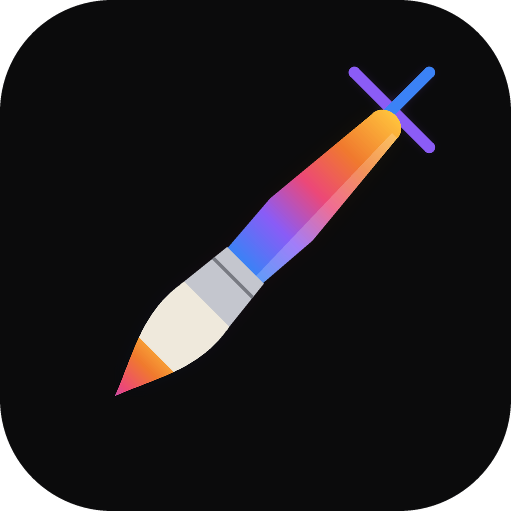

<p align="center">
  
</p>

<h1 align="center">LinPaintX</h1>

<p align="center">
  <b>Приложение для рисования с открытым исходным кодом для Android-телефонов и планшетов, Windows и Linux, с собственным движком на Rust и GPU-рендерером: интерфейс на Kotlin/Jetpack Compose на Android и тот же интерфейс на egui на десктопе.</b><br>
  Кисти с учётом нажима, слои с режимами наложения, коррекции, выделение и трансформация, анимация и 3D-рисование — всё написано с нуля.
</p>

<p align="center">
  <a href="https://github.com/Linvyxai/LinPaintX/releases"></a>
  <a href="https://apps.obtainium.imranr.dev/redirect?r=obtainium://add/https://github.com/Linvyxai/LinPaintX"></a>
  <a href="https://t.me/+nZFfv72736czZmFi"></a>
</p>

<p align="center">
  <a href="https://t.me/+nZFfv72736czZmFi"></a>
  
  
  
  
  
  
  
  
</p>

<p align="center">
  <sub>Из <a href="https://github.com/Linvyxai/LinPaintX/releases">Releases</a>: устройствам Android нужен <code>arm64.apk</code> (<code>legacy-arm32.apk</code> — только для старых 32-битных устройств) или Obtainium для обновлений; Windows — установщик <code>.msi</code> или портативный <code>.zip</code>; Linux — <code>.AppImage</code>, <code>.deb</code> или <code>.tar.gz</code> (видео и PDF там используют системные <code>ffmpeg</code> и <code>poppler-utils</code>).</sub>
</p>

<p align="center">
  <a href="#рисование">Рисование</a> ·
  <a href="#слои-и-цвет">Слои и цвет</a> ·
  <a href="#коррекции-и-трансформация">Коррекции и трансформация</a> ·
  <a href="#действия">Действия</a> ·
  <a href="#планы">Планы</a> ·
  <a href="#сборка">Сборка</a>
</p>

<br>

<p align="center">
  
  <br>
  <sub><b>Закат</b>, нарисованный с чистого холста на Lenovo Legion Tab: библиотека кистей, палитра, слои, защёлкнутое и залитое солнце, залитые так же холмы, сосны, звёзды с Bloom. Около 1:20; <a href="docs/images/demo.mp4">полное видео</a> (MP4, 2:21) показывает каждое меню почти в реальном темпе. Каждый штрих — штрих пером с нажимом, с плавным началом и концом, проигран <a href="tools/showcase">демо-скриптом</a>.</sub>
</p>

<br>

<p align="center">
  
  <br>
  <sub>Холст: инструменты сверху, размер и непрозрачность сбоку, весь экран для рисунка.</sub>
</p>

<br>

## Рисование

<table>
<tr>
<td width="50%"><br><sub>Библиотека кистей: одиннадцать наборов собственных кистей, каждая с превью-штрихом.</sub></td>
<td width="50%"><br><sub>Студия кисти: путь штриха, стабилизация, сужение, форма, зерно, рендеринг, влажное смешивание, динамика цвета и многое другое, с пробой на планшете.</sub></td>
</tr>
</table>

<br>

## Слои и цвет

<table>
<tr>
<td width="50%"><br><sub>Слои с режимами наложения, непрозрачностью, блокировкой альфы, обтравочными масками, масками и группами. Слои, не помещающиеся в GPU, хранятся сжатыми, поэтому работы с сотнями слоёв открываются и рисуются плавно.</sub></td>
<td width="50%"><br><sub>Цвет: диск, классический, гармония, значение (с hex) и палитры.</sub></td>
</tr>
</table>

<br>

## Коррекции и трансформация

<table>
<tr>
<td width="50%"><br><sub>Оттенок, насыщенность, яркость на слое неба, в реальном времени. Также цветовой баланс, кривые, карта градиента, размытия, шум, резкость, свечение, глитч, полутон, хроматическая аберрация, пластика и клонирование — на слое или нарисованные поверх.</sub></td>
<td width="50%"><br><sub>Трансформация: свободная, равномерная, искажение и деформация, с прилипанием. Выделение: автоматическое, от руки, прямоугольник и эллипс, с растушёвкой.</sub></td>
</tr>
</table>

<br>

## Действия

<p align="center">
  
  <br>
  <sub>Действия: добавить файлы, фотографии и текст; холст, его направляющие и помощники; поделиться как PNG, JPEG, PSD, PDF, TIFF, GIF или MP4; таймлапс каждой работы; настройки и управление жестами.</sub>
</p>

<br>

## Планы

LinPaintX находится в бете — на Android (телефоны и планшеты) и на десктопе (Windows и Linux).

| Область | Статус |
|---|---|
| Холст: верхняя панель, боковая панель (размер, непрозрачность, изменение, отмена, повтор), полный экран, жесты (щипок, поворот, быстрая подгонка, касания двумя и тремя пальцами, смахивание для очистки) | ✅ |
| Движок кистей: источники формы и зерна, путь штриха, стабилизация, сужение, рендеринг и глазури, влажное смешивание, динамика цвета, нажим и наклон пера; библиотека и студия кисти | ✅ |
| Слои: режимы наложения, непрозрачность, блокировка альфы, обтравочные маски, маски, группы, слияние, референсный слой; большие работы хранятся сжатыми вне GPU | ✅ |
| Цвет: диск, классический, гармония, значение и палитры; история; пипетка; заливка перетаскиванием цвета на холст | ✅ |
| Коррекции, каждая со своей панелью, на слое или нарисованные поверх | ✅ |
| Выделение (автоматическое, от руки, фигуры, растушёвка) и трансформация (свободная, равномерная, искажение, деформация, прилипание) | ✅ |
| Фигуры, которые защёлкиваются ровно, направляющие и помощник рисования (2D, изометрия, перспектива, симметрия), текст | ✅ |
| Анимация и помощник страниц, окно референса | ✅ |
| Галерея: стопки, пресеты нового холста, импорт и экспорт (PNG, JPEG, PSD, PDF, TIFF, GIF, MP4), таймлапс | ✅ |
| 3D-рисование: модели OBJ и USDZ, наборы текстур, рисование по сетке, свет и окружение | ✅ |
| Десктоп: Windows и Linux, тот же интерфейс с мышью, графическим планшетом и горячими клавишами; установщик, AppImage и .deb | 🚧 бета |
| Плагины: файлы `.linx-plug-in`, которые вы импортируете в Настройки › Плагины; каждый выключен, пока вы его не включите, и исчезает без следа при выключении. Фильтры (несколько строк WGSL, в разделе Коррекции) и изолированный WebAssembly, меняющий поведение приложения, например Размер интерфейса, Смещение касания и Замыкание промежутков ColorDrop. Как написать: [docs/plugins.md](docs/plugins.md) | 🚧 экспериментально |
| Больше для плагинов: собственные панели и инструменты, и плагины, способные использовать команды приложения | ⬜ |
| Телефоны: собственное приложение, LinPaintX Pocket (это для планшетов). Обычный LinPaintX ставится и на экран телефона: пальцем рисует с первого запуска (проверено на экране 1080×2400) | 🚧 модуль собирается, интерфейс с нуля |

<sub>✅ работает сегодня · 🚧 в работе · ⬜ не начато · 🚫 не планируется</sub>

<br>

## Сборка
*Одна команда Gradle собирает всё приложение: она компилирует движок на Rust с [cargo-ndk](https://github.com/bbqsrc/cargo-ndk) и генерирует привязки Kotlin.*

* Клонируйте этот репозиторий
* Убедитесь, что есть не меньше 6 ГБ свободного места на диске
* войдите в `android` и выполните `./gradlew assembleRelease -Pprocraft.abis=arm64-v8a`, либо откройте эту папку в Android Studio и нажмите Run.
* десктопное приложение: `cargo run --release -p procraft-desktop` из корня репозитория; его установщик и пакеты — через `packaging/windows/package.ps1` (WiX v5, а значит и .NET SDK) и `packaging/linux/package.sh` (nfpm, appimagetool).

`android/app/build/outputs/apk/release/app-release.apk` перезаписывается каждой сборкой и не содержит в имени ABI: сборка с `-Pprocraft.abis=x86_64` (для эмулятора) кладёт в тот же файл архив, который на arm64-планшет не встанет. Перед установкой смотри список `lib/` внутри APK или собирай с нужным `-Pprocraft.abis` и сразу копируй файл с именем ABI (как делает релизный workflow в `dist/`).

Зависимости времени сборки:

<details>
  <summary>необходимые инструменты</summary>

  ```
      rustup с целями aarch64-linux-android и x86_64-linux-android
      cargo install cargo-ndk --version "^4" --locked
      Android SDK (API 37) и NDK 29.0.14206865
      JDK 17 или новее
  ```
</details>

`cargo test --workspace` запускает тесты движка и рендерера на десктопе.

| Путь | Что |
|---|---|
| `crates/engine` | документ, кисти, геометрия штриха, вид холста (без GPU) |
| `crates/gpu` | рендерер wgpu: слои, штрихи, композитинг, отображение |
| `crates/core` | общее для обоих приложений над рендерером: сессия холста, каждое касание и жест, состояние инструментов (коррекции, трансформация, выделение, обрезка, Перекрашивание) и какую из них завершает кнопка, галерея, пресеты, градиенты, таймлапс, файлы библиотеки кистей, меню слоя, экспорт и его имена файлов, горячие клавиши; с привязками UniFFI Android-приложения |
| `android` | приложение для Android (Gradle) |
| `desktop` | десктопное приложение (egui) для Windows и Linux |
| `packaging` | установщик Windows и пакеты Linux десктопного приложения, как их собирает релизный workflow |

*Сборки проверяются только на Windows 11.*

<br>

## Лицензия

[MIT](LICENSE-MIT) OR [Apache-2.0](LICENSE-APACHE), на ваш выбор.

- **Сторонние материалы:** шрифт Inter, иконки Lucide и светлые панорамы, которые поставляет приложение, а также библиотеки, на которых оно построено, перечислены в [NOTICE](NOTICE).
- **Каждый ресурс**, с его автором, источником и лицензией, — в [ATTRIBUTION.md](ATTRIBUTION.md).
- **Иконки** нарисованы векторными контурами ([`tools/icons/draw_icons.py`](tools/icons/draw_icons.py), по [руководству по стилю](docs/icons/STYLE_GUIDE.md)).
- **Демо-картина**, *Закат*, — наша собственная, сделана в приложении.

<br>

## Заметки для себя

Старайтесь использовать [семантические коммиты](https://kapeli.com/cheat_sheets/Semantic_Commits.docset/Contents/Resources/Documents/index). Используйте `feat:` / `fix:` / `chore:` / `docs:` / и т.д.
